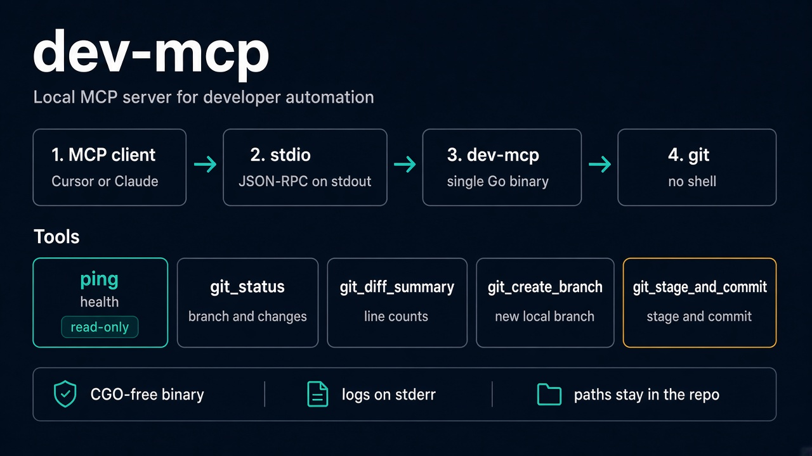
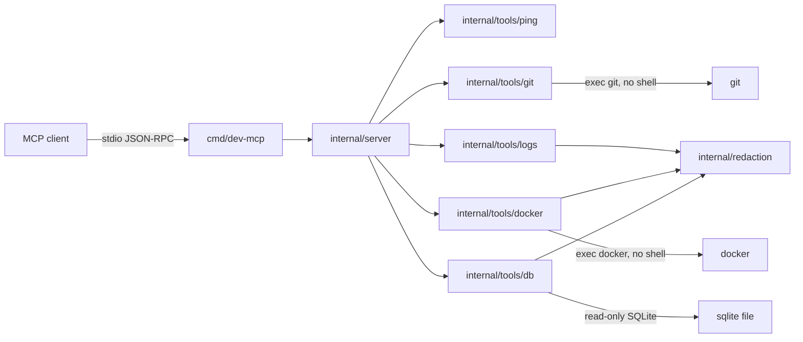

# dev-mcp

`dev-mcp` is a single-binary [Model Context Protocol](https://modelcontextprotocol.io) server for local developer automation. It speaks JSON-RPC 2.0 on stdin/stdout through [`github.com/modelcontextprotocol/go-sdk`](https://github.com/modelcontextprotocol/go-sdk). The binary is CGO-free. It exposes a health check, git workflow tools, log redaction, read-only Docker health, and read-only SQLite schema and migration status.

Logs go to stderr so they never mix with the protocol stream on stdout.



The figure shows the stdio process and the original git tools. Log, Docker, and database tools are documented below.

JSON-RPC stays on stdout. Logs stay on stderr. Git arguments are a vector, not a shell string, and commit paths stay inside the repository.

## Status

| Step | Scope | State |
| --- | --- | --- |
| 1 | Project scaffolding, stdio server, `ping` | done |
| 2 | Git workflow tools | done |
| 3 | Log capture and redaction | done |
| 4 | Docker and container health | done |
| 5 | Database schema and migrations | done |
| 6 | Packaging, release config, final docs | done |

## Requirements

- Go 1.27 or newer
- `git` on `PATH` for the git tools. `ping` still runs when git is absent; those tools return an error instead.
- `docker` on `PATH`, and a reachable daemon, for the Docker tools. The other tools still run when Docker is absent.
- A SQLite file for `db_schema` and `db_migrations`. Those tools use the CGO-free driver built into the binary. They do not need a database CLI.

## Quickstart

```bash
go build -o dev-mcp ./cmd/dev-mcp
```

Build without cgo:

```bash
CGO_ENABLED=0 go build -o dev-mcp ./cmd/dev-mcp
```

On Windows the output file is `dev-mcp.exe`. Running the binary with no arguments waits for an MCP client on stdin. Stop it with Ctrl+C.

Print the version and exit before the server starts:

```bash
./dev-mcp --version
```

That line is plain text on stdout. It is not a JSON-RPC message. `-version` does the same thing.

Set the version string at build time:

```bash
CGO_ENABLED=0 go build -trimpath \
  -ldflags "-X github.com/ManiaSacha/dev-mcp/internal/version.Version=0.1.0" \
  -o dev-mcp ./cmd/dev-mcp
```

## Releases

Pushing a tag such as `v0.1.0` to this repository runs `.github/workflows/release.yml`. The workflow builds `CGO_ENABLED=0` archives for Linux, macOS, and Windows, on `amd64` and `arm64`. The version baked into those binaries is the tag with the leading `v` removed. Each archive is named `dev-mcp_<version>_<os>_<arch>` and is a `.tar.gz`, or a `.zip` on Windows. The GitHub Release also includes `checksums.txt` with SHA-256 sums.

The tag must start with `v` and the remainder may contain only letters, digits, `.`, `_`, `+`, and `-`. The workflow does not run on pull requests. It runs `go vet` and the race tests first, and builds no archives if they fail. CI on `main` and on pull requests checks that a default build prints the version set in `internal/version/version.go`.

## Tools

### `ping`

Read-only health check. It takes no arguments and returns:

| Field | Meaning |
| --- | --- |
| `status` | `ok` when the handler ran |
| `name` | MCP implementation name (`dev-mcp`) |
| `version` | Server version. Source builds report `0.1.0`. A release binary reports the tag without the leading `v` |

### `git_status`

Read-only status of a local working tree. `path` is optional and may be the work tree or a directory inside it. When `path` is omitted, the server uses its working directory.

| Field | Meaning |
| --- | --- |
| `root` | Absolute work tree path |
| `branch` | Current branch, or `HEAD` when detached |
| `detached` | Whether HEAD is detached |
| `upstream` | Upstream branch, when one is configured |
| `ahead`, `behind` | Commit counts relative to the upstream |
| `clean` | True when there is nothing to report |
| `entries` | Staged, unstaged, renamed, and untracked paths |

Each entry has `path`, `index`, and `worktree`. A rename or copy also has `originalPath`. Index and worktree use words such as `modified`, `added`, `deleted`, `renamed`, and `untracked`.

### `git_diff_summary`

Read-only line counts from `git diff --numstat`. `path` works the same way as `git_status`. `staged` limits the result: `true` returns the index, `false` returns unstaged worktree changes, and omitting it returns both. Untracked files are not part of the diff; `git_status` reports those.

Each side (`staged`, `unstaged`) includes `files`, `additions`, `deletions`, and `fileCount`. A binary file has `binary: true` and zero counts. A detected rename includes `originalPath`.

### `git_create_branch`

Creates a local branch.

| Argument | Meaning |
| --- | --- |
| `path` | Optional work tree, same as `git_status` |
| `name` | Required branch name. It must not start with `-`, and `git check-ref-format --branch` must accept it |
| `startPoint` | Optional commit-ish. Defaults to `HEAD`. Values that start with `-` are rejected |
| `checkout` | Omit or `true` to switch to the new branch. `false` creates it without switching |

The result reports `root`, `branch`, `head`, and `checkedOut`. `head` is empty when the branch does not point at a commit yet.

### `git_stage_and_commit`

Creates one commit. It does not sign the commit. Hooks still run.

| Argument | Meaning |
| --- | --- |
| `path` | Optional work tree, same as `git_status` |
| `message` | Required non-empty commit message |
| `paths` | Repository-relative files to commit. Their worktree content is recorded. Other staged files stay staged and are left out of the commit |
| `all` | `true` stages every change in the work tree, including untracked files and deletions, then commits the index. Cannot be combined with `paths` |

One of `paths` or `all` is required. Absolute paths and paths that escape the work tree are rejected. The result reports `root`, `branch`, `detached`, `hash`, `subject`, and `files`.

### `logs_tail`

Reads the end of a regular log file and masks secrets before returning the lines. `path` is required. `lines` defaults to 200 and cannot exceed 2000.

Files larger than 8 MiB are scanned from the end. `truncated` is true in that case, and `lineOrigin` is `window` instead of `file`. A line longer than 16 KiB is cut and marked. The result also reports `redactions` and `scannedBytes`.

### `logs_search`

Finds lines that contain `query` as literal text. Regular expression syntax is not interpreted. `matches` limits how many lines come back (default 100, maximum 500). `ignoreCase` compares without case when true. Matching lines are redacted. The same 8 MiB end-of-file window as `logs_tail` applies. `matchLimitReached` is true when more matches existed than the limit.

### `logs_redact`

Masks secrets in text the caller supplies. The text is not written to disk. The maximum input is 1 MiB. The result is `text` plus `redactions`.

Recognized secrets include passwords and token assignments, `user:password` URLs, `Authorization: Bearer` and `Authorization: Basic` values, private key blocks, and common token shapes from GitHub, Slack, AWS, Stripe, Google, OpenAI, and JWTs. The replacement text is `[REDACTED]`.

### `docker_info`

Read-only check of the local Docker client and daemon. It uses the Docker context of the server process. The result reports `status`, `clientVersion`, `serverVersion`, `apiVersion`, `os`, and `arch`.

### `docker_ps`

Lists containers, including stopped ones. `state` is optional and must be `created`, `restarting`, `running`, `paused`, `exited`, or `dead`. `name` is an optional literal substring matched after Docker returns. Each container includes `id`, `name`, `image`, `state`, `status`, and `health` when the status text reports a health check.

### `docker_health`

Reads one container's status, restart count, and the last five health-check results. `container` is a name or id. It must not start with `-`. Check output is redacted. Environment variables, mounts, and the rest of `docker inspect` are not returned. `health` is `none` when the container has no health check.

### `docker_logs`

Returns a redacted tail of one container's logs. `lines` defaults to 100 and cannot exceed 1000. The call does not follow the stream. Stdout lines are listed before stderr lines. `timestamps` prefixes each Docker line with its timestamp when true.

### `db_schema`

Reads tables, columns, indexes, and foreign keys from a local SQLite file. `path` is the database file. The file is opened read-only. Rows are not returned, and the tool does not accept SQL.

| Field | Meaning |
| --- | --- |
| `path` | Database file that was read |
| `tables` | User tables, excluding `sqlite_` internal tables |
| `tableCount` | Number of tables returned |
| `truncated` | True when a table, column, index, or foreign-key limit was hit |

Each table has `columns`, `indexes`, and `foreignKeys`. A column includes `name`, `type`, `notNull`, `primaryKey`, and a redacted `default` when one is declared. Limits are 200 tables, 200 columns, 50 indexes, and 50 foreign keys per table.

### `db_migrations`

Lists versioned migration filenames in one directory and, when `database` is set, reports which forward versions are not applied. SQL in the files is not read or executed. Nested directories are ignored.

| Argument | Meaning |
| --- | --- |
| `directory` | Required directory of migration files |
| `database` | Optional SQLite file used to compare applied versions |

Recognized names are `N_name.up.sql`, `N_name.down.sql`, and `N_name.sql`. `up` and `sql` are forward migrations. `down` files are listed and are never pending.

| Field | Meaning |
| --- | --- |
| `tracker` | `none`, `golang-migrate`, or `goose` |
| `dirty` | True when golang-migrate recorded a failed migration at the current version |
| `files` | Recognized filenames, ordered by version |
| `pending` | Forward versions that are not applied |
| `truncated` | True when more than 1000 recognized files were present |

golang-migrate stores one current version in `schema_migrations`. Versions below that ceiling are applied. The ceiling version is applied only when `dirty` is false. goose stores each `version_id` in `goose_db_version`. When both tables exist, `schema_migrations` is used. With no tracker table, every forward version is pending. The tool does not apply migrations.

## Restricting file access

By default the file-reading tools (`logs_tail`, `logs_search`, `db_schema`, `db_migrations`, and the git tools' `path`) accept any path the server's user can read. Set `DEV_MCP_ALLOWED_ROOTS` to limit them. It is a list of directories separated by `:` (`;` on Windows):

```bash
DEV_MCP_ALLOWED_ROOTS="$HOME/projects:/var/log/myapp" ./dev-mcp
```

When the variable is set, a path must resolve inside one of the roots after symlinks are followed. A path that does not exist, or a variable whose roots all fail to resolve, refuses every request. Set it in your client's `env` block (for example `"env": {"DEV_MCP_ALLOWED_ROOTS": "/home/me/projects"}`). Redaction is best-effort, so keep sensitive directories out of the roots.

## Client configuration

Use the absolute path to the binary you built. The snippets below assume that path.

### Cursor

`.cursor/mcp.json`:

```json
{
  "mcpServers": {
    "dev-mcp": {
      "command": "C:\\path\\to\\dev-mcp.exe"
    }
  }
}
```

### Claude Desktop

`claude_desktop_config.json`:

```json
{
  "mcpServers": {
    "dev-mcp": {
      "command": "C:\\path\\to\\dev-mcp.exe",
      "args": []
    }
  }
}
```

## Architecture



```text
dev-mcp/
├── cmd/dev-mcp/           # process entrypoint and signal handling
├── internal/
│   ├── server/            # MCP server, tool registration, stdio transport
│   ├── tools/
│   │   ├── ping/          # health tool
│   │   ├── git/           # status, diff summary, branch, commit
│   │   ├── logs/          # tail, search, and redact
│   │   ├── docker/        # daemon, containers, health, logs
│   │   └── db/            # sqlite schema and migration status
│   ├── redaction/         # secret masking for log text
│   └── version/           # name and version advertised to clients
├── docs/                  # README infographic
├── .github/workflows/     # test, lint, and tagged releases
├── go.mod
├── LICENSE
└── README.md
```

`internal/server.New` constructs the SDK server, points its logger at stderr, and registers tools. `internal/server.Run` owns the stdio transport. Tool handlers receive `context.Context` and return before doing work when the context is already cancelled. Git tools run `git` with `exec.CommandContext`, so a cancelled context stops the child process. Log tools read regular files and pass every returned line through `internal/redaction`. Docker tools run `docker` with `exec.CommandContext` and redact health-check output and container logs the same way. Database tools open a SQLite file read-only and do not run migration SQL. Column defaults go through the same redaction engine.

## Development

```bash
go test -v -race ./...
golangci-lint run ./...
```

`go test -race` uses the race detector runtime. On Linux and Windows that runtime is built with cgo, so the machine needs a C compiler (GCC on Linux, MinGW-w64 on Windows). The `dev-mcp` binary itself is still built with `CGO_ENABLED=0`. CI provides the compiler.

CI runs both the race tests and golangci-lint v2.15.0 on pull requests and on pushes to `main`. The same workflow builds a CGO-free binary and checks `dev-mcp --version`. Tagged releases are a separate workflow.

## Security notes for this revision

- Tool handlers do not invoke a shell. There is no `sh -c` or `bash -c` path.
- `ping` accepts no caller-controlled command text.
- Git receives a fixed argument vector. The repository path is the child process working directory, not a `-C` option assembled from a shell string.
- Branch names and start points that begin with `-` are rejected before git sees them. Branch names also have to pass `git check-ref-format --branch`. Start points are checked with `git rev-parse --verify --end-of-options`.
- Commit paths must stay inside the work tree. They are written to `git add` on stdin with NUL separators, and `git commit --only --` records those paths without a shell. `GIT_LITERAL_PATHSPECS=1` keeps pathspecs literal.
- `git_stage_and_commit` passes `--no-gpg-sign`, so a configured signer cannot block the call. It does not pass `--no-verify`.
- `GIT_TERMINAL_PROMPT=0` stops git from asking for credentials on the terminal.
- `logs_tail` and `logs_search` open a regular file. They do not start a program. A file larger than 8 MiB is read from the end only.
- Log text returned to the client passes through the redaction engine. Assignments, credential URLs, authorization headers, private keys, and common token shapes are replaced with `[REDACTED]`.
- `logs_search` treats the query as literal text.
- `DEV_MCP_ALLOWED_ROOTS` optionally limits the paths that the log, database and git tools may read. It is unset by default, which allows every path.
- Docker tools do not start, stop, or remove containers. Container names that start with `-` are rejected. `docker_ps` only forwards a state from a fixed list.
- `docker_health` returns status and health-check output. It does not return environment variables or mounts. Log and health text is redacted.
- Database tools do not accept caller SQL and do not apply migrations. A SQLite file is opened with `mode=ro` and `PRAGMA query_only`.
- `db_schema` returns structure only. Column defaults are redacted. Rows are not returned.
- `db_migrations` lists filenames in one directory. It reads `schema_migrations` or `goose_db_version` when a database file is provided. When both tables exist, `schema_migrations` is used.
- Cancellation is checked in the handler and before `Run` starts the transport.
- Protocol bytes stay on stdout. The default logger writes to stderr.
- `--version` and `-version` print `dev-mcp` and the build version, then exit. They do not start the stdio server.

## License

[MIT](LICENSE). Copyright (c) 2026 ManiaSacha.
