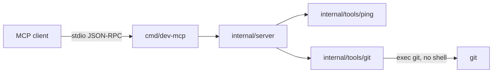

# dev-mcp

`dev-mcp` is a single-binary [Model Context Protocol](https://modelcontextprotocol.io) server for local developer automation. It speaks JSON-RPC 2.0 on stdin/stdout through [`github.com/modelcontextprotocol/go-sdk`](https://github.com/modelcontextprotocol/go-sdk). This revision adds local git workflow tools on top of the `ping` health check.

The process is CGO-free. Logs go to stderr so they never mix with the protocol stream on stdout.

## Status

| Step | Scope | State |
| --- | --- | --- |
| 1 | Project scaffolding, stdio server, `ping` | done |
| 2 | Git workflow tools | current |
| 3 | Log capture and redaction | not started |
| 4 | Docker and container health | not started |
| 5 | Database schema and migrations | not started |
| 6 | Packaging, release config, final docs | not started |

## Requirements

- Go 1.27 or newer
- `git` on `PATH` for the git tools. `ping` still runs when git is absent; those tools return an error instead.

## Quickstart

```bash
go build -o dev-mcp ./cmd/dev-mcp
```

Build without cgo:

```bash
CGO_ENABLED=0 go build -o dev-mcp ./cmd/dev-mcp
```

On Windows the output file is `dev-mcp.exe`. Running the binary with no arguments waits for an MCP client on stdin. Stop it with Ctrl+C.

## Tools

### `ping`

Read-only health check. It takes no arguments and returns:

| Field | Meaning |
| --- | --- |
| `status` | `ok` when the handler ran |
| `name` | MCP implementation name (`dev-mcp`) |
| `version` | Server version (`0.1.0`) |

### `git_status`

Read-only status of a local working tree. `path` is optional and may be the work tree or a directory inside it. When `path` is omitted, the server uses its working directory.

| Field | Meaning |
| --- | --- |
| `root` | Absolute work tree path |
| `branch` | Current branch, or `HEAD` when detached |
| `detached` | Whether HEAD is detached |
| `upstream` | Upstream branch, when one is configured |
| `ahead`, `behind` | Commit counts relative to the upstream |
| `clean` | True when there is nothing to report |
| `entries` | Staged, unstaged, renamed, and untracked paths |

Each entry has `path`, `index`, and `worktree`. A rename or copy also has `originalPath`. Index and worktree use words such as `modified`, `added`, `deleted`, `renamed`, and `untracked`.

### `git_diff_summary`

Read-only line counts from `git diff --numstat`. `path` works the same way as `git_status`. `staged` limits the result: `true` returns the index, `false` returns unstaged worktree changes, and omitting it returns both. Untracked files are not part of the diff; `git_status` reports those.

Each side (`staged`, `unstaged`) includes `files`, `additions`, `deletions`, and `fileCount`. A binary file has `binary: true` and zero counts. A detected rename includes `originalPath`.

### `git_create_branch`

Creates a local branch.

| Argument | Meaning |
| --- | --- |
| `path` | Optional work tree, same as `git_status` |
| `name` | Required branch name. It must not start with `-`, and `git check-ref-format --branch` must accept it |
| `startPoint` | Optional commit-ish. Defaults to `HEAD`. Values that start with `-` are rejected |
| `checkout` | Omit or `true` to switch to the new branch. `false` creates it without switching |

The result reports `root`, `branch`, `head`, and `checkedOut`. `head` is empty when the branch does not point at a commit yet.

### `git_stage_and_commit`

Creates one commit. It does not sign the commit. Hooks still run.

| Argument | Meaning |
| --- | --- |
| `path` | Optional work tree, same as `git_status` |
| `message` | Required non-empty commit message |
| `paths` | Repository-relative files to commit. Their worktree content is recorded. Other staged files stay staged and are left out of the commit |
| `all` | `true` stages every change in the work tree, including untracked files and deletions, then commits the index. Cannot be combined with `paths` |

One of `paths` or `all` is required. Absolute paths and paths that escape the work tree are rejected. The result reports `root`, `branch`, `detached`, `hash`, `subject`, and `files`.

## Client configuration

Use the absolute path to the binary you built. The snippets below assume that path.

### Cursor

`.cursor/mcp.json`:

```json
{
  "mcpServers": {
    "dev-mcp": {
      "command": "C:\\path\\to\\dev-mcp.exe"
    }
  }
}
```

### Claude Desktop

`claude_desktop_config.json`:

```json
{
  "mcpServers": {
    "dev-mcp": {
      "command": "C:\\path\\to\\dev-mcp.exe",
      "args": []
    }
  }
}
```

## Architecture



```text
dev-mcp/
├── cmd/dev-mcp/           # process entrypoint and signal handling
├── internal/
│   ├── server/            # MCP server, tool registration, stdio transport
│   ├── tools/
│   │   ├── ping/          # health tool
│   │   ├── git/           # status, diff summary, branch, commit
│   │   ├── logs/          # placeholder
│   │   ├── db/            # placeholder
│   │   └── docker/        # placeholder
│   ├── redaction/         # placeholder
│   └── version/           # name and version advertised to clients
├── .github/workflows/     # go test -race and golangci-lint
├── go.mod
└── README.md
```

`internal/server.New` constructs the SDK server, points its logger at stderr, and registers tools. `internal/server.Run` owns the stdio transport. Tool handlers receive `context.Context` and return before doing work when the context is already cancelled. Git tools run `git` with `exec.CommandContext`, so a cancelled context stops the child process.

## Development

```bash
go test -v -race ./...
golangci-lint run ./...
```

`go test -race` uses the race detector runtime. On Linux and Windows that runtime is built with cgo, so the machine needs a C compiler (GCC on Linux, MinGW-w64 on Windows). The `dev-mcp` binary itself is still built with `CGO_ENABLED=0`. CI provides the compiler.

CI runs both the race tests and golangci-lint v2.15.0 on pull requests and on pushes to `main`.

## Security notes for this revision

- Tool handlers do not invoke a shell. There is no `sh -c` or `bash -c` path.
- `ping` accepts no caller-controlled command text.
- Git receives a fixed argument vector. The repository path is the child process working directory, not a `-C` option assembled from a shell string.
- Branch names and start points that begin with `-` are rejected before git sees them. Branch names also have to pass `git check-ref-format --branch`. Start points are checked with `git rev-parse --verify --end-of-options`.
- Commit paths must stay inside the work tree. They are written to `git add` on stdin with NUL separators, and `git commit --only --` records those paths without a shell. `GIT_LITERAL_PATHSPECS=1` keeps pathspecs literal.
- `git_stage_and_commit` passes `--no-gpg-sign`, so a configured signer cannot block the call. It does not pass `--no-verify`.
- `GIT_TERMINAL_PROMPT=0` stops git from asking for credentials on the terminal.
- Cancellation is checked in the handler and before `Run` starts the transport.
- Protocol bytes stay on stdout. The default logger writes to stderr.
